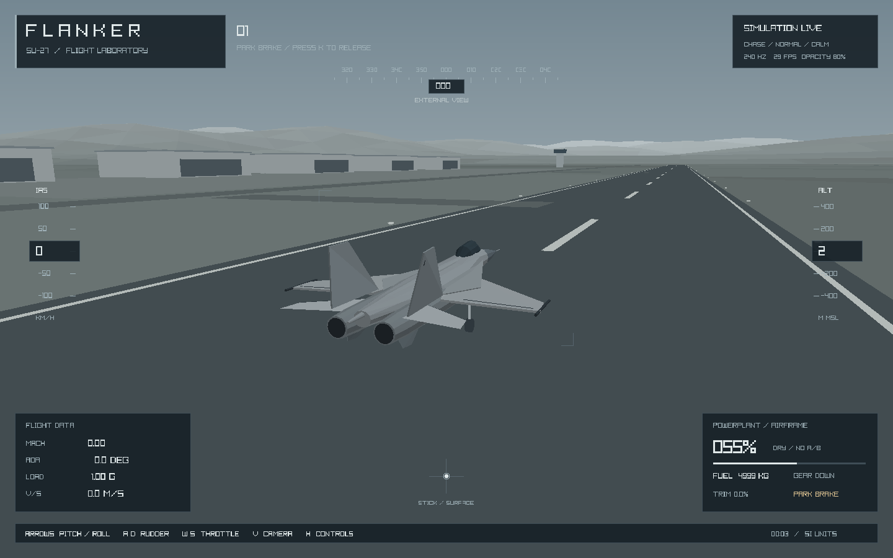
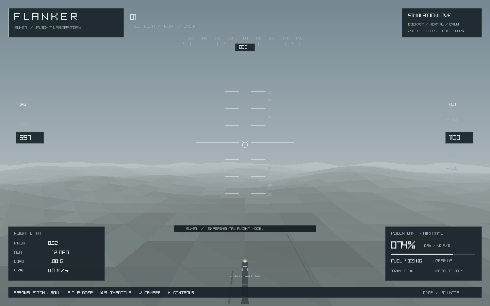

# FLANKER — Су-27 Flight Laboratory

Трёхмерный симулятор самолёта на **C# / .NET 10 / Raylib**. Сдержанная серая палитра,
процедурная модель Су-27, аэродром и горная долина. Основной акцент — динамика полёта,
а не боевые задания или эффекты. Для запуска не нужны Unity, Godot или редактор сцен.

## Запуск в VS Code

1. Установите **[.NET 10 SDK](https://dotnet.microsoft.com/download/dotnet/10.0)**,
   VS Code и расширение **C# Dev Kit**. Нужен именно SDK, не только Runtime.
2. Распакуйте ZIP или клонируйте репозиторий, откройте папку с `Plane.csproj`.
3. В терминале этой папки выполните:

```sh
dotnet run
```

Первый запуск сам восстановит пакет `Raylib-cs` из NuGet. Все исходники приложения —
файлы `.cs`; точка входа — `Program.cs`, проект — `Plane.csproj`.
`Ctrl+Shift+B` собирает проект, `F5` запускает отладку. `Esc` закрывает окно.

Поддерживаемые пакетом платформы: Windows x64, Linux x64, macOS x64/Apple Silicon.
В этой разработке проверены Linux x64, .NET SDK 10.0.402 и Mesa OpenGL.
Windows и macOS требуют отдельной проверки на этих ОС.
Нужен графический рабочий стол и OpenGL 3.3; это настольная программа, не веб-приложение.

Linux (Debian/Ubuntu), если отсутствуют системные библиотеки:

```sh
sudo apt-get update
sudo apt-get install libgl1 libx11-6 libxcursor1 libxrandr2 libxinerama1 libxi6 libasound2t64
```

На старых версиях Ubuntu пакет ALSA называется `libasound2`.

## Первый полёт

Приложение открывается на взлётной полосе: **самолёт неподвижен, шасси выпущены,
газ на нуле, форсаж выключен**. Разбег и взлёт выполняет пилот самостоятельно.
Газ, триммер и траекторию меняет пилот: автопилота и автоматического
поддержания высоты/скорости нет.

| Клавиши | Действие |
| --- | --- |
| ↑ / ↓ | Отдать ручку / взять на себя; опустить / поднять нос |
| ← / → | Крен влево / вправо |
| A / D | Руль направления; на земле также носовое колесо |
| W / S | Увеличить / уменьшить газ |
| Left Shift | Включить / выключить форсаж; действует при полном газе |
| Q / E | Триммер: нос вниз / нос вверх |
| G | Выпуск / уборка шасси, занимает 3,5 секунды |
| B | Воздушный тормоз |
| Space | Держать колёсные тормоза |
| V | Внешняя камера → кабина → свободный облет |
| ПКМ + мышь | Вращение камеры в режиме ORBIT |
| Колесо мыши | Приближение / отдаление внешней камеры |
| N | Ветер с порывами, по умолчанию штиль |
| Tab | Векторы подъёмной силы, тяги и скорости |
| P / H | Пауза / памятка управления |
| R | Новый старт на полосе с нулевым газом |
| T | Новый старт на полосе с нулевым газом |

Геймпад: левый стик — крен/тангаж, правый X — руль направления, мёртвая зона 6%.
Клавиатура остаётся доступной при подключённом геймпаде. Газ и переключатели — клавиатурой.

**Взлёт:** `T`, держите `W` до 100%, включите форсаж `Left Shift`. Около
260 км/ч по прибору плавно берите ручку на себя короткими нажатиями `↓`.
После отрыва уберите шасси. Клавиатура задаёт полный ход ручки, поэтому не
удерживайте её постоянно: добейтесь нужного тангажа, отпустите и подстройте триммер.
Числа здесь — ориентиры для этого прототипа, не руководство к настоящему самолёту.

**Посадка:** ориентир 280–310 км/ч IAS, шасси выпущены, небольшая вертикальная
скорость; после касания уменьшите газ и держите `Space`. Грубое касание
вертикальной скоростью более 8 м/с, удар крылом или фюзеляжем заканчивают полёт.

На приборах: IAS — эквивалентная приборная скорость из динамического давления
(без поправки на сжимаемость), ALT — метры над уровнем моря, RADALT — высота над
рельефом, AOA — угол атаки, LOAD — нормальная аэродинамическая перегрузка,
V/S — вертикальная скорость. Положение точки CONTROL INPUT показывает реальное
сглаженное отклонение исполнительных поверхностей.

## Физическая модель

- **Шесть степеней свободы:** интегрирование сил и уравнений Эйлера вращения
  `I·ω̇ = M − ω×(I·ω)`. Ориентация — нормализованный кватернион.
- **Фиксированный шаг 120 Гц**, независимо от частоты отрисовки. Длинные зависания
  ограничивают накопленный шаг: симуляция замедляется, вместо прыжка через землю.
- Все расчёты в **СИ**. Масса меняется по мере расхода топлива.
- **Атмосфера ISA:** плотность и скорость звука зависят от высоты, тропопауза 11 км.
- Подъёмная сила `L = ρV²S·CL/2`, углы атаки/скольжения из скорости относительно
  воздушной массы. Подъёмная сила перпендикулярна потоку, сопротивление направлено
  против него; крен наклоняет подъёмную силу и создаёт разворот.
- Профильное и индуктивное сопротивление, плавный трансзвуковой рост волнового
  сопротивления, дополнительные сопротивления шасси, скольжения и тормоза.
- Плавный переход к отрывному обтеканию: после критического угла атаки падают
  подъёмная сила и эффективность рулей, возрастает сопротивление. Самолёт может
  потерять высоту; скорость не приклеивается к направлению носа.
- Статические аэродинамические моменты, демпфирование по трём осям, ограниченная
  скорость приводов, отдельный триммер. Это не поворот модели по нажатию кнопки.
- **Два двигателя:** оценочная высотно-скоростная характеристика с влиянием
  скоростного напора на воздухозаборники, раскрутка, форсаж, расход топлива,
  прекращение тяги при пустых баках.
- Трёхточечные **пружинно-демпферные шасси**, контакт с тем же рельефом,
  который виден на экране, ограниченное сцеплением трение, руление, торможение.
- Предупреждения о сваливании, опасном снижении, перегрузке и топливе.
  Более 11 g по модулю или M 2,35 в течение 0,8 с приводит к условному разрушению.

Открытые размерные ориентиры: площадь крыла 62 м², размах 14,7 м,
пустая масса 16 300 кг, начальное топливо 5000 кг,
суммарная статическая тяга 149 кН без форсажа / 245,2 кН на форсаже.
Коэффициенты и моменты инерции вынесены в `Flight/AircraftParameters.cs`
и `Flight/Aerodynamics.cs`.

**Границы достоверности:** это работающий исследовательский прототип, а не
сертифицированная или откалиброванная модель настоящего Су-27. Аэродинамические
коэффициенты, инерции и характеристики двигателя оценочные. Критический угол
атаки 18° выбран для прототипа и не является паспортным ограничением Су-27.
Не моделируются реальная СДУ/ограничитель угла атаки Су-27, вихревая подъёмная сила
на больших углах, точные штопорные режимы, ground effect, упругость конструкции,
отказы отдельных систем, приборные ошибки, сжимаемость в IAS и работа воздухозаборников
по реальным таблицам. Для следующего уровня достоверности нужны проверенные таблицы
`CL/CD/Cm(α,β,M,δ)` и сравнение с лётными испытаниями. Здесь нет заявления об их наличии.

Теоретические ориентиры:
[NASA: lift equation](https://www.grc.nasa.gov/www/k-12/airplane/lifteq.html),
[NASA: drag equation](https://www.grc.nasa.gov/www/k-12/airplane/drageq.html),
[JSBSim reference manual](https://jsbsim-team.github.io/jsbsim-reference-manual/).
JSBSim не является зависимостью проекта.

## Проверки

```sh
dotnet restore --locked-mode
dotnet build -c Release --no-restore
dotnet run -c Release --no-build -- --self-test
```

Физические тесты обходятся без окна и GPU. Они проверяют атмосферу ISA,
квадратичную зависимость сил от скорости, работу аэродинамических сил, сваливание,
волновое сопротивление, триммированный полёт, направления реакции рулей, двигатели,
топливо, стоянку на шасси, взлёт, удар о землю, потерю энергии в планировании,
разворот при крене, кватернион и сходимость интегрирования при 120/240 Гц.
Процесс возвращает ненулевой код, если хотя бы одна проверка не прошла.

Проверка графики в рабочем столе:

```sh
dotnet run -c Release --no-build -- --smoke-test
```

Она отрисовывает 420 кадров: начальная стоянка, полёт снаружи, вид из кабины; проверяет
состояние физики, неподвижность, нулевой газ и выпущенные шасси при старте,
контакт на стоянке и разнообразие пикселей, сохраняет три PNG
в `artifacts/` и завершается. Для Linux без монитора:

```sh
sudo apt-get install xvfb
xvfb-run -a dotnet run -c Release --no-build -- --smoke-test
```

Сам по себе тест отрисовки не доказывает лётную достоверность модели.

## Структура

```text
Plane.csproj                  .NET 10, закреплённый пакет Raylib-cs
Program.cs                    Точка входа, команды проверок
SimulatorApp.cs               Окно, ввод, цикл фиксированного шага
Flight/                       Атмосфера, силы, моменты, двигатели, шасси
Rendering/                    Процедурный Су-27, мир, камеры, приборы
Simulation/                   Рельеф и исполняемые физические тесты
.vscode/                      Сборка, отладка и рекомендации расширений
docs/                         Снимки работающего прототипа
```

Все модели создаются программно: скачивать сторонние 3D-ресурсы не нужно.
`packages.lock.json` фиксирует граф зависимостей. В CI запускаются Release-сборка
и физические тесты. Архив исходников не включает SDK, `bin/`, `obj/` и кэш NuGet.




