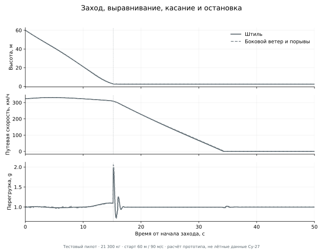

# Проверка управляемости, захода и посадки

Сравнение с коммитом `1191f23`: TAS 175 м/с, высота 1100 м, топливо 5000 кг,
масса 21 300 кг, штиль. Команда начинается из нуля. Половина тангажа удерживается
2 секунды; половина крена — 1 секунду, затем ручка отпускается.

Это сравнение **двух версий симуляции**, не результаты полётов настоящего Су-27.
Старая версия управляла поверхностями напрямую; новая по умолчанию использует
NORMAL. Разница включает закон управления и переработку инерции/аэродинамики.

| Метрика | `1191f23`, старый DIRECT | Новая версия, NORMAL |
| --- | ---: | ---: |
| Пик скорости тангажа, половина ручки / 2 с, °/с | 50.37 | 6.45 |
| Пик перегрузки, половина ручки / 2 с, g | 8.42 | 2.65 |
| Крен через 1 с, половина команды, ° | 108.09 | 21.39 |
| Пик скорости крена в первую секунду, °/с | 129.19 | 42.61 |

Исходные значения: [предыдущая версия](handling-reference-1191f23.json),
[текущая проверка](flight-validation.json). Чтобы повторить текущие сценарии:

```sh
dotnet run -c Release -- --flight-report
```

## Что изменено

- Пустая конструкция разбита на 12 компонентов общей массой 16 300 кг.
  Инерция рассчитывается из их размеров и положения, затем добавляются три
  топливных бака. При начальной загрузке диагональ тензора по осям
  тангаж/рыскание/крен — **404830 / 457874 / 66866 кг·м²**.
  Ранее было 177 466 / 200 312 / 25 153 кг·м². Распределение компонентов оценочное.
- Внешние участки крыла расположены внутри его планформы, а сила корневых
  наплывов приложена отдельно к ним: 48 м² внешних участков и 14 м² корневой зоны.
  Это оценочное разбиение суммарной площади 62 м². Локальная оценка запаса
  статической устойчивости — 6.61% средней аэродинамической хорды;
  это параметр прототипа, а не паспортное значение Су-27.
- NORMAL задаёт перегрузку и угловую скорость, а не мгновенный разворот.
  Регуляторы используют время в секундах; проверяется сходимость при 240/480 Гц.
  Фактические скорости вращения, положение и g не зажимаются программно.
- Предиктор угла атаки учитывает текущую скорость его изменения. Защита не
  отключается при падении скорости: при недостатке эффективности рулей остаётся
  физическая ошибка слежения, а не скрытая подмена динамики.
- На больших углах атаки элероны разгружаются, крен создаётся дифференциальными
  стабилизаторами. Это устраняет положительную обратную связь из-за обратного
  действия элерона на срывающемся крыле.
- Давление фюзеляжа приложено к пяти продольным секциям вместо одной точки у носа.
  Возникает демпфирование от местного потока при вращении; уменьшен искусственный
  задирающий момент после срыва.
- Стояночная поза решается из веса и сил амортизаторов: самолёт не падает на
  стойки при запуске.
- Эффект экрана изменяет и подъёмную силу присоединённого потока, и индуктивное
  сопротивление. При выравнивании самолёт дольше выдерживается над полосой;
  полностью сорванное крыло не получает искусственной прибавки подъёмной силы.
- Скос потока переносится от левого/правого полукрыльев к стабилизаторам с
  задержкой, зависящей от скорости и расстояния. Отрыв на крыле также уменьшает
  напор на хвосте. Силовые оценки внутри шага не продвигают историю следа повторно.
- Ветер имеет логарифмический профиль по высоте над рельефом. На высоте крыла
  сохраняется боковой ветер; над горой профиль начинается от местной поверхности.
  Двенадцать пространственных мод порывов переносятся ветром и не зависят от
  порядка вызовов генератора случайных чисел или частоты кадров.
- Носовое колесо свободно вращается, тормозятся основные. Антиюз отслеживает
  проскальзывание, быстро сбрасывает и медленно восстанавливает давление.
  При скольжении снижается боковое сцепление, силы ограничены кругом трения.

## Заход и остановка

Начальные условия: масса 21 300 кг, высота 60 м над плоским аэродромом,
путевая скорость вдоль полосы 90 м/с, вертикальная скорость −4 м/с, начало
за 2300 м до центра полосы. Тестовый пилот выпускает шасси, выравнивает,
убирает газ на высоте 5 м и после касания тормозит основными колёсами.
Результат вычисляется силами/моментами без подмены состояния во время полёта.

| Сценарий | Вертикальная скорость касания, м/с | Пробег до скорости <1 м/с, м | Максимальное отклонение от оси, м |
| --- | ---: | ---: | ---: |
| Штиль | 1.76 | 806 | <0.01 |
| Боковой ветер 4 м/с на высоте 10 м, порывы | 1.90 | 814 | 3.2 |

В обоих случаях самолёт останавливается в пределах полосы. Воздушная и путевая
скорости записываются раздельно. Удельная механическая энергия считается по
путевой скорости; в ветре воздушная масса может совершать работу над самолётом.



Это воспроизводимые результаты прототипа с автоматическим тестовым пилотом,
а не характеристики реального Су-27. В игре взлёт и посадку выполняет пользователь.
Совпадение с MSFS не измерено; для такой оценки нужны сопоставимые лётные данные.

## Сценарии

Сейчас проходят **37 физических тестов и 14 лётных сценариев**. Последние
проверяют половинный/полный ввод, отпускание ручки без выравнивания крыльев,
манёвр при 250 м/с, защиту на малой скорости, снижение при крене 60° и 1 g,
планирование без двигателей, стоянку, взлёт и выход из срыва в DIRECT.
Дополнительно проверяются минута полёта в порывах, взлёт с боковым ветром,
заход/касание/остановка в штиль и с боковым ветром. Сходимость при 240/480 Гц
проверяется в NORMAL и DIRECT, с ветром и без него.

Срывной сценарий начинает разгрузку при измеренном отрыве потока, гасит рыскание
и уменьшает угол атаки. Он не сбрасывает ориентацию, скорость или положение.
В текущем прогоне максимальный угол — 50.5°,
после восстановления степень отрыва — 1.4e-06.
Это проверка конкретного управляемого сценария, не доказательство восстановления
из любого штопора или режима обратного обтекания.

Взлётная проверка использует тестового пилота, отпускающего стояночный тормоз,
подающего полный газ/форсаж и начинающего ротацию при 82 м/с. Высота 4 м над
рельефом достигнута через 484 м от точки старта.
Это значение для указанной массы и протокола, не заявленная характеристика Су-27.

Текущие кривые записываются в `artifacts/flight-telemetry.csv` с частотой 20 Гц.
Программа возвращает ненулевой код, если нарушен любой допуск. Допуски описывают
инженерно ожидаемое поведение и не заменяют калибровку по измеренным
аэродинамическим таблицам, характеристикам СДУ и лётным испытаниям.
